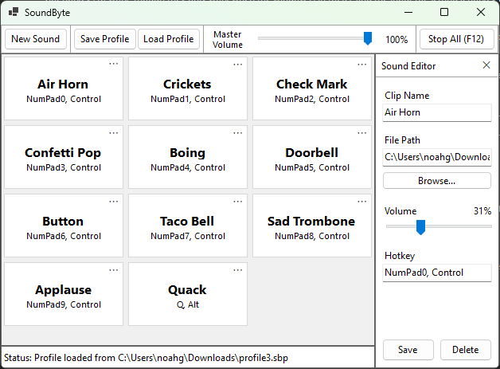
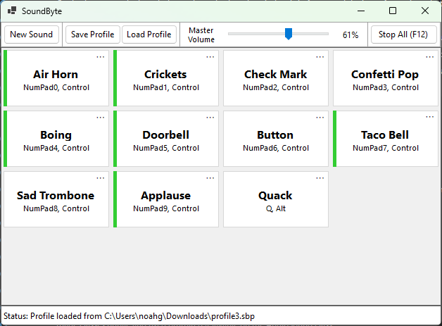

## Purpose
SoundByte is a clean desktop soundboard application that allows users to manage and play audio clips via tiles or custom hotkeys.

 

## Application Background
Developed as a Final Project for a Software Development course, this application demonstrates object-oriented programming (OOP) principles, hardware-level key capture, file storage, and modern .NET features such as asynchronous tasks.

## How to Run
1. Clone the repo to your local machine.
2. Open the `SoundByte.slnx` file in Visual Studio.
3. Click "Start" to run the application.

## How to Use the Interface
* **Navitation:** Use the top toolbar to access the master volume and global actions.
* **Adding Sound Tiles:** Click the "New Sound" Button in the toolbar to add a new tile.
* **Editing:** Click the ellipses (⋯) button on and sound tile to open its properties in the editor.
* **Clearing/Deleting:** Use the "Delete" button in the editor to remove its tile and clear its back-end audio player.
* **Saving Changes:** Use the "Save" button in the editor to update an existing audio tile, or finish adding a new one.
* **Playing Audio:** Click a tile to play its audio, or press its assigned global hotkey combination.

## Controls & Events Implemented
**Controls Used:**
* `Form` and `Panel` controls for layout structure.
* `TableLayoutPanel` and `FlowLayoutPanel` for responsive window resizing.
* Custom-built `UserControl` (SoundTile) which populates the main grid.
* `Label` controls for labeling, `Button` for buttons, `TextBox` for input, and `TrackBar` for volume.
* `OpenFileDialog` and `SaveFileDialog` for system file browsing.

**Key Features & Logic:**
* **Audio Engine:** Uses NAudio and WASAPI (in shared mode to allow for concurrent playback) to play audio, with a manually implemented `ISampleProvider` interface that fades audio out to prevent popping on restart.
* **Global Hotkeys:** Implements `user32.dll` (specifically, `GetAsyncKeyStates`) alongside a polling timer to capture complex key combinations (e.g., Ctrl+Shift+Key) even when the application is unfocused.
* **Profile Saving/Loading:** Uses `System.Text.Json` to serialize the back-end list of `HotkeySound` objects into savable profile files, that can be loaded.

## Validation Included
The application prevents saving invalid tile configs by verifying:
* `Clip Name` and `File Path` are not empty or whitespace.
* The specified file path exists
* The file is of a supported file type (I currently explicitly support `.wav`, `.mp3`, `.m4a`, `.aac`, `.wma`, and `.flac`).

If validation fails, an error is displayed in the status bar, and focus is pulled to the invalid input.

## Known Limitations
My implementation of NAudio loads entire audio files into memory upon creation to allow for instant playback. Loading massively long audio files (such as podcasts or ambient sounds) may result in high RAM usage.
